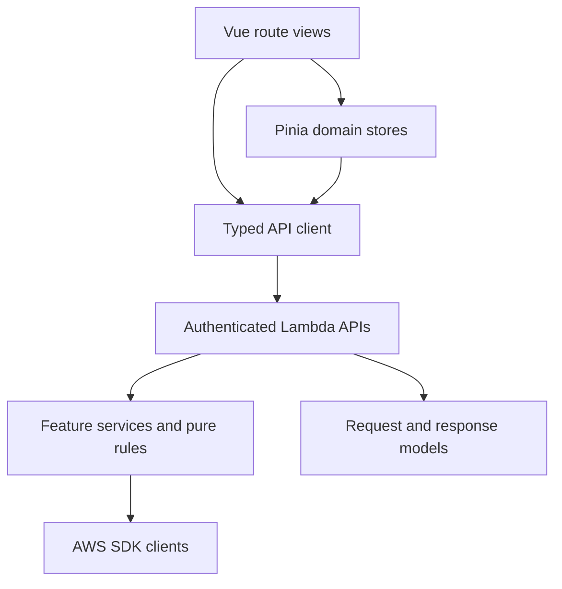

# Source responsibilities and dependency direction

## Purpose

This document describes the intended source boundaries and the refactoring completed in this change. Runtime behavior and existing API payloads remain the compatibility contract.

## Dependency direction

- Vue route views own semantic markup and local interaction state. Shared cross-screen state belongs in a named Pinia store.
- The typed API client owns network requests and consistent error conversion. Utilities contain deterministic transformations such as CSV and ICS generation.
- Lambda handlers parse transport events through `LambdaRequestParser`, verify authorization, call feature logic, and shape API Gateway responses.
- Feature services own a single feature's validation and persistence work. Pure rules such as score deltas do not know about HTTP or AWS.
- DynamoDB and S3 access stays behind feature-specific services or repositories. `ScheduleRepository` owns schedule/facility table requests and `BasketballRepository` owns scorebook table access. A refactor must preserve table names, keys, and endpoint payloads unless an API migration is separately designed.

## Current feature boundaries

| Feature               | Browser entry point                                | Lambda entry point                       | Extracted responsibility                                                                                           |
| --------------------- | -------------------------------------------------- | ---------------------------------------- | ------------------------------------------------------------------------------------------------------------------ |
| Schedule              | `CalendarView`, `ScheduleFormView`, schedule store | `ScheduleApi` → `ScheduleRepository`     | API validation and persistence stay separate from calendar display, form state, and shared schedule caching.       |
| Calendar export       | `frontend/src/utils/exports.ts`                    | Schedule API through the typed client    | Owns ICS generation and monthly share-text formatting.                                                             |
| Announcements         | `HomeView`, `AnnouncementsView`                    | `ScheduleApi` → `AnnouncementService`    | Views own display and editing state; the service validates and persists records.                                   |
| Basketball scorebook  | Team, game, score and ranking views                | `BasketballApi` → `BasketballRepository` | Views split management workflows; the repository owns table access and `BasketballStatistics` owns stat deltas.    |
| Calendar image import | `ScheduleFormView`, upload store                   | `UploadApi`, `ImageProcessor`            | Direct S3 upload, persistent polling, image extraction, and schedule persistence remain separate responsibilities. |
| Facilities            | `FacilitiesView`                                   | `FacilityApi`                            | Facility CRUD remains isolated from schedule and scorebook behavior.                                               |

## Naming rules

- Java types use nouns or noun phrases in `UpperCamelCase`; methods use clear verbs in `lowerCamelCase`; constants use `UPPER_SNAKE_CASE`.
- JavaScript functions use descriptive `lowerCamelCase` verbs. Keep selectors and DOM IDs aligned with the feature name.
- Prefer feature terms such as `AnnouncementService`, `BasketballStatistics`, and `parseMigrationCsv` over generic names such as `Helper`, `Manager`, or `Util`.
- Use a shared utility only when multiple callers need the same deterministic behavior. AWS access, authorization, and feature validation belong in explicitly named feature components.
- Write comments and Javadoc in Japanese. Keep identifiers in English. Document reasoning, constraints, and side effects rather than restating each line.

## Safe refactoring sequence

1. Preserve the current API route, authentication requirements, DynamoDB table/key shape, and browser-visible behavior.
2. Extract deterministic rules first and cover them with fast tests that need no network or AWS credentials.
3. Extract one feature's persistence behind a named service and keep the Lambda handler as a thin router.
4. Move browser behavior into a focused route view, store, API client, or deterministic utility; avoid global mutable state.
5. Update the architecture, source inventory, authorization, screen-flow, and development documents when a boundary changes.
6. Run local tests and static checks. Never use a production AWS endpoint as a test target.

## Remaining decomposition opportunities

`BasketballApi` still coordinates multiple scorebook workflows. Table access sits behind `BasketballRepository`; the next server-side boundary is to separate team, game, and ranking services while keeping transaction, clock, undo, and existing-record behavior covered by contract tests. `ScheduleApi` still owns authentication, route dispatch, schedule mapping, and several write workflows; read and write services can be separated after endpoint contract coverage is expanded. The Vue authentication callback and major route workflows are candidates for browser-level integration tests.

## Cost boundary

Unit and static checks are local and make no AWS requests. Do not trigger CodePipeline, Lambda deployment, CloudFront invalidation, Gemini extraction, or paid external APIs as part of local refactoring verification.
