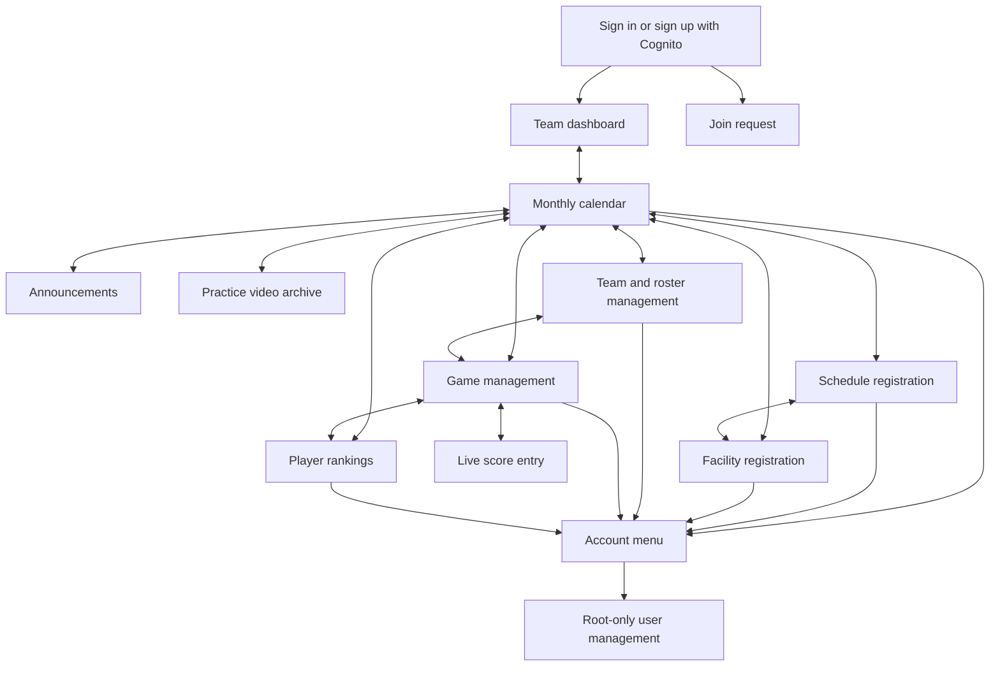

# Screen flow and navigation

The Vue SPA is served from `/app/`. Its persistent application shell contains the brand, theme control, account entry, and role-aware navigation. Route views are replaced inside the shell without a full page reload.

The common navigation is present on the calendar, schedule registration, facility registration, and scorebook screens. On narrow displays the navigation scrolls horizontally. The active destination uses `aria-current="page"` and a visible highlight.

## Navigation behavior

- `/app/#/` is the authenticated dashboard. It summarizes today, the next seven days, announcements, and common actions.
- `/app/#/calendar` is the monthly schedule view. A schedule opens its detail dialog, and an empty date can prefill registration.
- `/app/#/join` handles native Cognito registration, email-code confirmation, Google registration, and the approval-pending state.
- `/app/#/schedules/new`, `/facilities`, and `/announcements` are shown to administrators.
- `/app/#/videos`, `/teams`, `/games`, and `/rankings` are shared team destinations.
- `/app/#/games/:gameId` is the live scorebook. It controls the lineup, clock, play actions, undo, box score, and game completion.
- `/app/#/users` lets administrators approve participation requests. Root-only account changes remain protected by the Java API.
- Every top-level screen links to the other destinations through the same navigation bar.
- The account menu is available on every authenticated screen and contains the role label, account identifier, sign-out action, and guarded self-service account deletion.
- Root administrators also see the user-management destination, where they can promote, demote, disable, enable, or delete other accounts.

## Roles

Signed-in members can read the calendar, visible announcements, facilities, team roster, completed game results, and rankings. Administrators can additionally create and edit schedules, facilities, announcements, teams, roster entries, and games, and record score actions. Root administrators inherit those rights and can manage accounts. The server checks the role on every protected request; hiding a form in the browser is not an authorization control.
